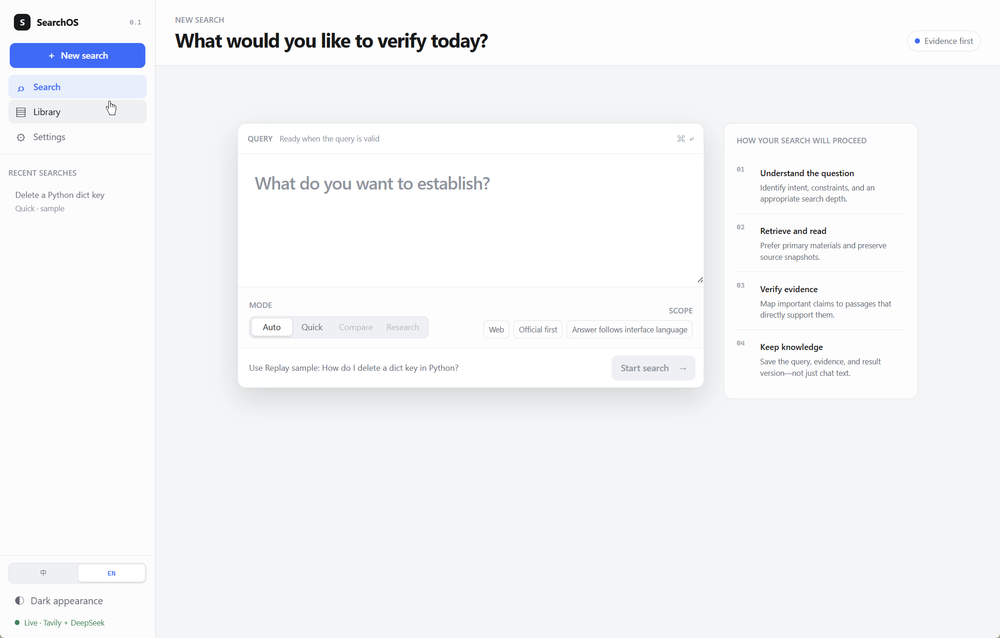
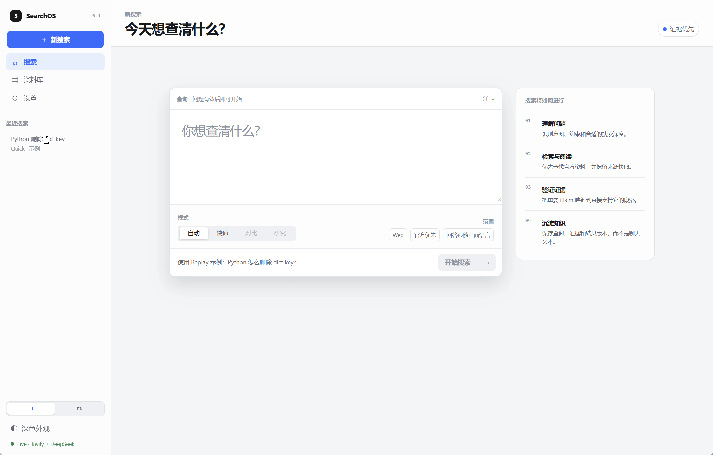
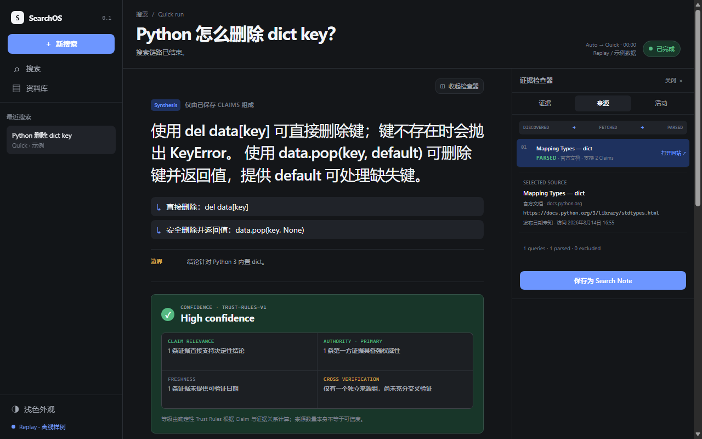
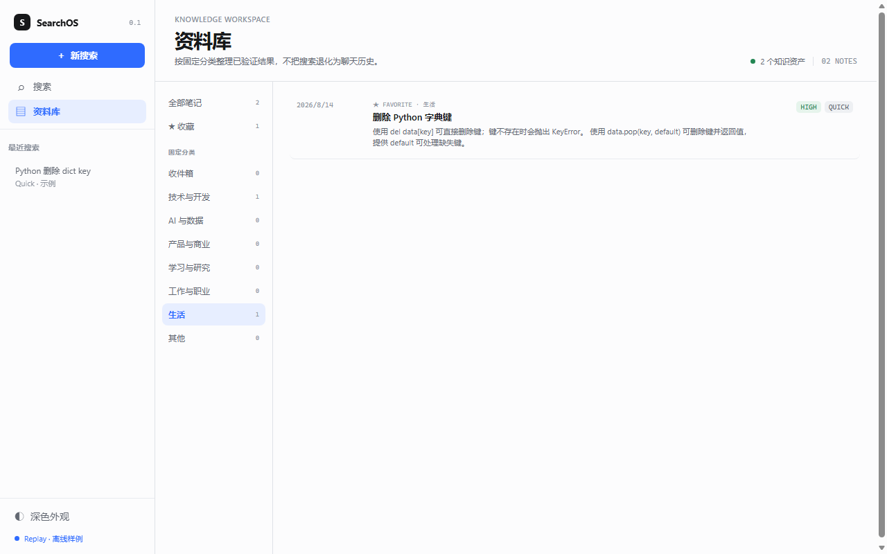
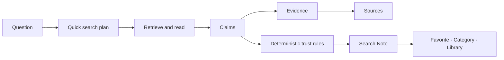

# Siftory

> **Search, verify, and keep what you learn.**

[GitHub](https://github.com/shadecyj/siftory) · [简体中文](README.zh-CN.md) · [Product docs](docs/01-PRD.md) · [Security](SECURITY.md) · [MIT License](LICENSE)

**Siftory** is an evidence-first search agent for turning a question into a reviewable knowledge record. Instead of treating a search as a disposable chat response, it connects each important **Claim** to the **Evidence** that supports it and the **Source** it came from—then lets you save, favorite, categorize, and reopen the result from your Library.

`v0.1.0 Preview` · Quick search vertical slice · Windows desktop (Tauri) + source run · English / Simplified Chinese



<details>
<summary>Chinese UI walkthrough</summary>


</details>

## Why Siftory

Most AI search experiences stop at an answer. Siftory is designed around the fuller loop:

```text
Find information → verify it → understand it → organize it → save it → revisit it
```

| System | What it helps with | V0.1 implementation |
| --- | --- | --- |
| Search Engine | Find relevant material | Quick task flow, source retrieval, bounded supplemental retrieval, Replay / Live runtime |
| Trust Engine | Judge a conclusion in context | Claim → Evidence → Source links, deterministic confidence rules, conflict and insufficiency guards |
| Knowledge Engine | Keep what was learned | Search Note, favorites, fixed categories, personal notes, local Library and reopen |

The central object is a **Claim**, not a URL and not a chat message:

```text
Question
  └── Search Task
        └── Claim
              └── Evidence
                    └── Source
        └── Search Note → Favorite / Category / Personal note
```

That structure makes a result inspectable now and gives later updates a stable unit to build on.

## What works today

Siftory v0.1 is intentionally a narrow, end-to-end **Quick** search slice. It is ready to demonstrate and evaluate, rather than presenting future modes as already available.

| Capability | Status in v0.1 |
| --- | --- |
| Quick search | Available. Ask a direct question; the app routes the current product flow through Quick. |
| Replay mode | Available with a deterministic, offline example. It is clearly labeled as Replay and does not claim to be live web search. |
| Live mode | Opt-in. Use your own supported search-provider and model-provider credentials to search the web. |
| Evidence inspection | Available. Open a Claim to inspect its evidence excerpt, locator/snapshot, source information, and source link. |
| Contextual confidence | Available. Rules consider direct claim relevance, authority / primary context, freshness, cross-verification, and meaningful conflicts. |
| Knowledge capture | Available. Save a result as a Search Note, favorite it, assign one of the current fixed categories, add a personal note, filter in Library, and reopen it. |
| Durable runtime | Available. Runs, checkpoints, and saved notes are persisted so completed work can be reopened. |
| Languages | Available. The product UI supports English and Simplified Chinese; source text, evidence excerpts, and user notes stay in their original language for traceability. |
| Windows desktop | Available as a Tauri-based Windows x64 build. |

The `Compare` and `Research` controls are deliberately disabled in v0.1. Export, accounts, collaboration, mobile apps, and automatic monitoring are also not part of this release.

## Evidence, not citation count

Siftory does not present a site-wide “trust score,” and it does not treat a citation count as proof. A confidence label is an explainable result of the relationship between a specific claim and its supporting evidence:

- Is the passage directly relevant to the claim?
- Is the source authoritative or primary for this question?
- Is the information fresh enough for the claim?
- Do independent sources corroborate it?
- Is there meaningful contradictory evidence or an evidence gap?

The confidence level is a review aid, **not a calibrated probability or a guarantee of truth**. Users can inspect the underlying evidence and source rather than relying on a black-box score.

## Product walkthrough

1. Start a Quick search or run the clearly marked Replay example.
2. Watch the visible search stages instead of hidden chain-of-thought.
3. Read the structured answer and its confidence explanation.
4. Open a Claim to trace it to an evidence passage and source.
5. Save the result as a Search Note, favorite or categorize it, and reopen it in Library.

| Evidence workspace | Library |
| --- | --- |
|  |  |

## Run it locally

### Fastest safe path: Replay

Replay needs no external service, API key, or network access.

```bash
npm ci
npm run dev
```

Open `http://localhost:3000`, then choose the Replay example on the home screen. It exercises the same result, evidence, trust, save, and Library flow using a known fixture.

### Live web search (optional)

Live mode needs a user-owned search-provider key and model-provider key. Supported adapters currently include Tavily / Brave Search and DeepSeek / OpenAI.

1. Copy [`.env.example`](.env.example) to an untracked local environment file such as `.env.local`.
2. Set `SEARCHOS_RUNTIME_MODE=live` and configure only the server-side variables for the providers you choose.
3. Start the app with `npm run dev`, then use Settings to verify the **redacted** runtime status.

`SEARCHOS_*` is the retained V0.1 compatibility namespace for internal configuration. Do not rename it to `SIFTORY_*` in a local setup.

Do not use `NEXT_PUBLIC_*` for provider keys. The browser workspace never needs to receive or store them. Live requests can consume provider quota and may incur costs; check your provider’s pricing, usage limits, and data policy before enabling them.

### Windows desktop build

Siftory includes a Tauri-based Windows x64 desktop target. End users of a published installer do not need Node.js or a database service. To build one from source, install the standard Tauri/Rust Windows prerequisites, then run:

```powershell
npm ci
npm run desktop:build
```

The publishable installer and checksum are collected under `dist/desktop/`. The desktop app starts in Replay mode without bundled keys. Live credentials are configured from its native credentials panel and protected by the current Windows user’s Credential Manager boundary.

For a source-run demo database and a replay fallback:

```bash
npm run demo:reset
npm run demo:replay
```

### Verify a checkout

```bash
npm run check
```

This runs linting, type checking, tests, production build checks, persistence checks, browser smoke coverage, and durable-runtime smoke coverage. Live smoke tests are intentionally opt-in because they access external providers.

## Architecture at a glance



The implementation uses strict boundary contracts, evidence anchors, deterministic trust rules, and durable persistence. The UI does not recompute trust from rendered HTML, and a Search Note is stored as structured data rather than as a screenshot or chat transcript.

## Roadmap

The next work is ordered to extend the same Claim-first model instead of adding unrelated surface features.

1. **Compare** — evaluate two or more options with symmetric `candidate × dimension` evidence, explicit trade-offs, missing evidence, and conflicts.
2. **Research** — run a bounded multi-step investigation with topic branches, evidence gaps, budgets, and resumable partial outcomes.
3. **Knowledge** — deepen the Library with richer organization, better personal-note workflows, structured export, and eventually manual Living Note updates.

See the [delivery plan](docs/05-DELIVERY-PLAN.md) and [domain model](docs/04-DOMAIN-MODEL.md) for the current technical foundation. Roadmap items are plans, not shipped features.

## Current limitations

- v0.1 implements Quick only; Compare and Research are not available yet.
- Live mode requires your own credentials, internet access, and provider availability. Replay is the reliable no-network fallback.
- Confidence is explainable rule-based evidence assessment, not a statistical truth guarantee.
- The desktop target is Windows x64 in this release line. The installer is not code-signed yet, so Windows may show a SmartScreen warning.
- Siftory is a local, single-user project at this stage. There is no authentication, cloud sync, team collaboration, or automatic long-term monitoring.

## Documentation

- [Product requirements](docs/01-PRD.md)
- [Information architecture](docs/02-INFORMATION-ARCHITECTURE.md)
- [Agent state machine](docs/03-AGENT-STATE-MACHINE.md)
- [Claim-first domain model](docs/04-DOMAIN-MODEL.md)
- [Runtime guide](docs/06-ROUND2-RUNTIME.md)
- [Durable runtime notes](docs/07-ROUND2-DURABLE-RUNTIME.md)
- [Desktop distribution](docs/09-DESKTOP-DISTRIBUTION.md)
- [Desktop credential boundary](docs/10-DESKTOP-SETTINGS-SECURITY.md)
- [Interview demo guide](docs/08-INTERVIEW-DEMO.md)
- [Security policy and release checklist](SECURITY.md)

## Contributing

Contributions and focused feedback are welcome. Please read [CONTRIBUTING.md](CONTRIBUTING.md), keep pull requests scoped, run `npm run check`, and never commit a real API key, database, or generated release artifact.

## License

Copyright © 2026 CYJIN. Released under the [MIT License](LICENSE).
