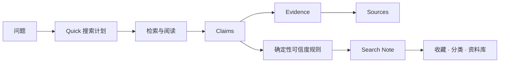

# Siftory

> **搜索、验证，并留下你学到的东西。**

[GitHub](https://github.com/shadecyj/siftory) · [English](README.md) · [产品文档](docs/01-PRD.md) · [安全说明](SECURITY.md) · [MIT License](LICENSE)

**Siftory** 是一个 Evidence First 的搜索 Agent：它会把一个问题沉淀为可审查的知识记录。系统不会只输出一段一次性的聊天回答，而是将重要 **Claim（结论）** 连接到支持它的 **Evidence（证据）** 与对应的 **Source（来源）**，然后允许用户保存、收藏、分类，并从资料库重新打开结果。

`v0.1.0 Preview` · Quick 搜索垂直闭环 · Windows 桌面版（Tauri）+ 源码运行 · English / 简体中文


<details>
<summary>English UI walkthrough</summary>


</details>

## 为什么是 Siftory

多数 AI 搜索在给出回答后就结束了。Siftory 面向的是更完整的链路：

```text
找信息 → 验证信息 → 理解信息 → 整理信息 → 保存信息 → 再次查看
```

| 系统 | 帮用户完成什么 | V0.1 当前实现 |
| --- | --- | --- |
| Search Engine | 找到相关资料 | Quick 任务流、来源检索、有限补搜、Replay / Live Runtime |
| Trust Engine | 在语境中判断结论 | Claim → Evidence → Source、确定性置信度规则、冲突与证据不足保护 |
| Knowledge Engine | 留下学习成果 | Search Note、收藏、固定分类、个人笔记、本地资料库与重新打开 |

项目的核心对象是 **Claim**，不是 URL，也不是聊天消息：

```text
Question
  └── Search Task
        └── Claim
              └── Evidence
                    └── Source
        └── Search Note → 收藏 / 分类 / 个人笔记
```

这让搜索结果可被审查，也让后续更新能围绕稳定的知识单位发生。

## V0.1 现在能做什么

Siftory v0.1 有意收敛为一条完整的 **Quick** 搜索闭环。它适合演示和验证，而不会把未来模式伪装为已经可用的功能。

| 能力 | V0.1 状态 |
| --- | --- |
| Quick 搜索 | 已可用。提出直接问题后，当前产品流会进入 Quick。 |
| Replay 模式 | 已可用。提供确定性的离线样例，界面会明确标识为 Replay，不会冒充实时网页搜索。 |
| Live 模式 | 可选开启。使用用户自己的搜索 Provider 与模型 Provider 凭据进行网页搜索。 |
| 证据检查 | 已可用。打开 Claim 可查看证据原文、定位/快照、来源信息与来源链接。 |
| 语境化置信度 | 已可用。规则会考虑结论直接相关性、权威性/第一方语境、时效性、交叉验证与有意义的冲突。 |
| 知识沉淀 | 已可用。可将结果保存为 Search Note、收藏、分配当前固定分类、补充个人笔记、在资料库筛选并重新打开。 |
| Durable Runtime | 已可用。Run、checkpoint 与已保存笔记会被持久化，已完成的工作可重新打开。 |
| 中英文界面 | 已可用。产品 UI 支持 English 与简体中文；来源文本、证据原文和个人笔记保持原语言，保证可追溯性。 |
| Windows 桌面版 | 已可用。提供基于 Tauri 的 Windows x64 构建目标。 |

`Compare` 与 `Research` 在 v0.1 中会明确保持禁用。导出、账号、协作、移动端和自动监控也不属于当前版本。

## 证据优先，而非引用数量优先

Siftory 不为网站给一个永久的“可信总分”，也不把引用数量当成证明。置信度来自某个具体 Claim 与其支持 Evidence 的关系：

- 该段证据是否直接支持这个 Claim？
- 对这个问题而言，来源是否权威或第一方？
- 信息是否足够新？
- 是否有独立来源交叉支持？
- 是否存在有意义的矛盾证据或证据缺口？

置信度用于帮助审查，**不是统计校准后的概率，也不保证结论必然为真**。用户可以继续查看证据和来源，而不必依赖黑盒分数。

## 产品演示链路

1. 发起 Quick 搜索，或运行清晰标识的 Replay 示例。
2. 观察可见的搜索阶段，而不是隐藏推理过程。
3. 阅读结构化回答和置信度说明。
4. 打开 Claim，追溯到具体证据段落与来源。
5. 保存为 Search Note，收藏或分类，并在资料库中重新打开。

| 证据工作区 | 资料库 |
| --- | --- |
|  |  |

## 本地运行

### 最快且安全的方式：Replay

Replay 不需要外部服务、API Key 或网络访问。

```bash
npm ci
npm run dev
```

访问 `http://localhost:3000`，然后在首页选择 Replay 示例。它会用确定性 fixture 演示同一套结果、证据、可信度、保存与资料库流程。

### Live 网页搜索（可选）

Live 模式需要用户自己的搜索 Provider Key 和模型 Provider Key。当前支持 Tavily / Brave Search，以及 DeepSeek / OpenAI adapter。

1. 将 [`.env.example`](.env.example) 复制为未提交的本地环境文件，例如 `.env.local`。
2. 设置 `SEARCHOS_RUNTIME_MODE=live`，并只配置所选 Provider 所需的服务端变量。
3. 使用 `npm run dev` 启动，再在 Settings 中查看**脱敏**后的 Runtime 状态。

`SEARCHOS_*` 是 V0.1 为兼容性保留的内部配置命名空间，本地配置时不要自行改成 `SIFTORY_*`。

不要把 Provider Key 放在 `NEXT_PUBLIC_*` 中。浏览器工作区不需要接收或保存密钥。Live 请求可能消耗 Provider 配额或产生费用；启用前请确认相应 Provider 的价格、用量限制与数据政策。

### Windows 桌面版构建

Siftory 包含基于 Tauri 的 Windows x64 桌面构建目标。已发布安装包的使用者不需要 Node.js 或数据库服务。若要从源码构建，请先安装标准 Tauri/Rust Windows 前置条件，再运行：

```powershell
npm ci
npm run desktop:build
```

可发布的安装包与校验和会收集到 `dist/desktop/`。桌面版默认以不含任何密钥的 Replay 启动。Live 凭据在原生凭据面板中配置，并受当前 Windows 用户的 Credential Manager 边界保护。

若需要重置演示数据并使用 Replay 兜底：

```bash
npm run demo:reset
npm run demo:replay
```

### 验证一次代码检出

```bash
npm run check
```

该命令会运行 lint、类型检查、测试、生产构建、持久化检查、浏览器冒烟覆盖和 durable runtime 冒烟覆盖。Live smoke 会访问外部 Provider，因此默认不会运行。

## 架构一览



实现中使用严格边界契约、证据锚点、确定性 Trust 规则和持久化存储。UI 不会从渲染后的 HTML 重新计算可信度，Search Note 也以结构化数据保存，而不是截图或聊天转录。

## 后续路线图

接下来的工作会继续扩展同一套 Claim-first 模型，而不是平铺无关功能：

1. **Compare** —— 通过对称的 `候选项 × 维度` 证据结构，展示取舍、缺失证据与冲突。
2. **Research** —— 通过受预算约束的多步研究、主题分支、证据缺口和可恢复的部分结果完成更深搜索。
3. **Knowledge** —— 深化资料库组织方式、个人笔记工作流、结构化导出，并逐步支持手动触发的 Living Note 更新。

技术基础可参考[交付计划](docs/05-DELIVERY-PLAN.md)与[数据模型](docs/04-DOMAIN-MODEL.md)。路线图是计划，不代表功能已经交付。

## 当前限制

- v0.1 只实现了 Quick；Compare 与 Research 尚不可用。
- Live 依赖用户自己的凭据、网络连接和 Provider 可用性；Replay 是可靠的离线兜底。
- 置信度是可解释的规则型证据评估，而不是统计意义上的真值保证。
- 本发布线的桌面目标为 Windows x64。安装包尚未代码签名，Windows 首次下载时可能显示 SmartScreen 提示。
- 目前是本地单用户项目；尚无登录、云同步、团队协作或自动长期监控。

## 文档

- [产品需求](docs/01-PRD.md)
- [页面信息架构](docs/02-INFORMATION-ARCHITECTURE.md)
- [Agent 状态机](docs/03-AGENT-STATE-MACHINE.md)
- [Claim-first 数据模型](docs/04-DOMAIN-MODEL.md)
- [Runtime 指南](docs/06-ROUND2-RUNTIME.md)
- [Durable Runtime 说明](docs/07-ROUND2-DURABLE-RUNTIME.md)
- [桌面分发说明](docs/09-DESKTOP-DISTRIBUTION.md)
- [桌面凭据安全边界](docs/10-DESKTOP-SETTINGS-SECURITY.md)
- [面试演示说明](docs/08-INTERVIEW-DEMO.md)
- [安全策略与发布检查](SECURITY.md)

## 贡献

欢迎提交聚焦的反馈和贡献。请阅读 [CONTRIBUTING.md](CONTRIBUTING.md)，保持 Pull Request 范围清晰，提交前运行 `npm run check`，并且绝不提交真实 API Key、数据库或生成的发布产物。

## 许可证

Copyright © 2026 CYJIN。项目以 [MIT License](LICENSE) 发布。
