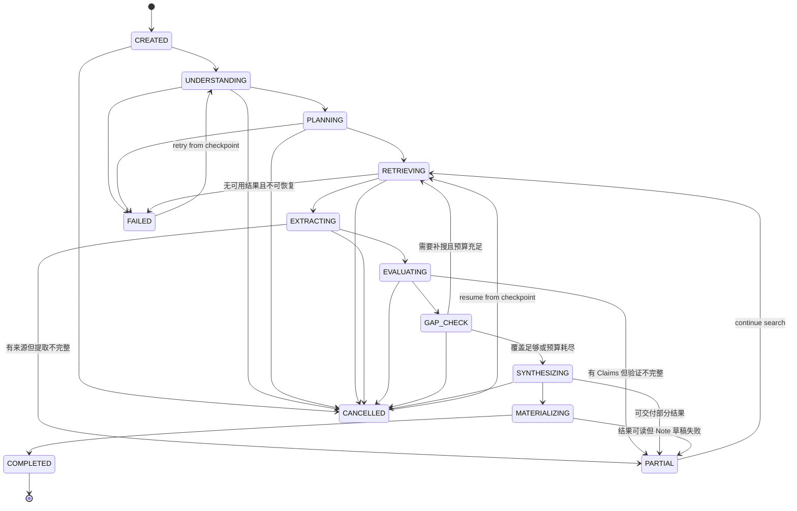

# Siftory V0.1 Agent 状态机

## 1. 设计目标

状态机必须同时保证：

- 搜索过程可理解、可取消、可重试；
- 多轮搜索有明确预算和停止条件；
- 单来源失败不导致整个任务丢失；
- Claim、Evidence、Source 在每一步都有 provenance；
- 相同事件重放不会生成重复知识对象；
- UI 的运行状态可以由持久化状态可靠恢复。

## 2. 生命周期边界

三个对象不可混用：

| 对象 | 生命周期 | 作用 |
| --- | --- | --- |
| SearchTask | 从用户问题创建后长期存在 | 保存原始问题、用户上下文和多个 Run |
| SearchRun | 一次具体的模式 + 计划 + 预算执行 | 保存完整 Agent 过程与结果，可重试、取消、比较 |
| SearchNote | 用户要长期保留的知识快照 | 从指定 Run 物化，可拥有后续 revisions |

关系：一个 SearchTask 有多个 SearchRuns；一个 SearchRun 最多生成一个初始 SearchNote；后续 Update 形成 NoteRevision，不覆盖历史。

## 3. 顶层状态机



`FAILED` 只用于没有可交付结果的终态；只要存在可理解的部分结果，就进入 `PARTIAL`。

## 4. 状态定义与输出契约

| 状态 | 核心动作 | 必须持久化的输出 | 下一步条件 |
| --- | --- | --- | --- |
| CREATED | 创建 Run、冻结输入和预算 | mode preference、request context、run id | 输入有效 |
| UNDERSTANDING | 规范化问题、判断意图和模式 | IntentAssessment、实体、约束、澄清假设 | 可形成搜索目标 |
| PLANNING | 分解目标、生成查询和来源策略 | SearchPlan、PlanSteps、停止条件 | 至少一个可执行 Step |
| RETRIEVING | 路由并执行 Web / Official / GitHub 查询 | SearchQuery、RetrievalAttempt、Source、Snapshot | 有新来源或预算结束 |
| EXTRACTING | 从 Snapshot 提取候选 Claims 与 Evidence | Claim candidates、Evidence spans | 有可验证陈述或背景材料 |
| EVALUATING | 评估支持关系、去重、交叉验证和冲突 | ClaimEvidence、TrustAssessment、Conflict | 每个关键 Claim 有状态 |
| GAP_CHECK | 检查覆盖、冲突和未知项 | GapAnalysis、next queries / stop reason | 补搜或停止 |
| SYNTHESIZING | 按模式组织答案 | StructuredResult | 结果通过一致性检查 |
| MATERIALIZING | 生成可保存的 SearchNote draft | SearchNote draft、NoteClaim links | 成功或可恢复失败 |
| COMPLETED | 关闭 Run | completed_at、final metrics | 终态 |
| PARTIAL | 交付不完整结果 | partial_reason、missing scope | 用户继续或终止 |
| FAILED | 保存不可交付失败 | error code、stage、retryability | 重试或终止 |
| CANCELLED | 停止新工作并保存 checkpoint | cancelled_at、last checkpoint | 恢复或终止 |

## 5. 模式策略

以下是 V0.1 的初始预算，属于可配置策略而不是领域模型常量；应通过黄金用例和成本数据调整。

| 策略 | Quick | Compare | Research |
| --- | --- | --- | --- |
| 首要目标 | 最短路径得到直接答案 | 对称取证后给出条件化建议 | 覆盖主题结构、共识、分歧与未知 |
| 计划粒度 | 1–2 个目标 | 每个候选共享比较维度 | 主题分支 + 覆盖问题 |
| 检索轮次上限 | 2 | 3 | 5 |
| 目标独立来源数 | 2–6 | 每个候选 3–6 | 全局 8–20 |
| 官方来源策略 | 有官方来源时优先 | 对每个候选对称优先 | 官方 + 原始研究 + 高质量二手综述 |
| 默认输出长度 | 简短 | 中等，结论 + 表格 | 分章节摘要 |
| 主要停止信号 | 直接证据已满足 | 关键维度均有可比证据 | 主题覆盖稳定且新增信息收益变低 |

预算耗尽不等于成功。预算耗尽时应进入 `SYNTHESIZING` 并把未覆盖项写入结果；若没有可交付证据则进入 `FAILED`。

## 6. Intent 与规划

### IntentAssessment

至少输出：

- normalized_question；
- selected_mode + mode_confidence；
- user_constraints（时间、地区、版本、预算、偏好）；
- entities / candidates；
- freshness_requirement；
- ambiguity_notes；
- assumptions。

V0.1 原则是“先以合理假设搜索，再允许纠正”。只有缺少的信息会让任何答案都明显失真时才阻塞并请求澄清。

### SearchPlan

每个 PlanStep 包含：

- goal：要解决的子问题；
- expected_claims：预计验证的结论类型；
- query_templates；
- preferred_source_types；
- completion_criteria；
- priority；
- dependencies。

Compare 模式必须保证比较对称：共享维度应同时为所有候选取证。若某候选缺证据，应显示缺失，不以另一个候选的资料代替。

## 7. Source Router

路由优先级由 Claim 类型和用户问题决定，不是固定网站白名单：

| Claim 类型 | 优先来源 |
| --- | --- |
| 产品能力、API、版本行为 | 官方文档、release notes、官方仓库 |
| 代码实现和 issue 状态 | 官方 GitHub repo、commit、issue / discussion |
| 学术结论 | 原始论文、数据集、研究机构 |
| 法规政策 | 官方法规、监管机构、政府页面 |
| 实际体验、兼容性 | 可复现实验、社区测试、专业评测 |
| 市场认知或用户反馈 | 多个独立二手来源，明确其非事实权威 |

Router 输出的是查询目标和 source type 偏好；最终可信度仍由具体 Evidence 对具体 Claim 的支持关系决定。

## 8. 检索与证据处理子流程

每个查询可并行访问多个来源，但单来源处理遵循：

```text
DISCOVERED
→ FETCHING
→ SNAPSHOTTED
→ PARSED
→ EVIDENCE_EXTRACTED
→ ASSESSED
```

异常分支：

```text
FETCHING → UNAVAILABLE / BLOCKED / TIMEOUT
PARSED → UNSUPPORTED_FORMAT / EMPTY
EVIDENCE_EXTRACTED → NO_RELEVANT_EVIDENCE
ASSESSED → EXCLUDED_DUPLICATE / EXCLUDED_LOW_RELEVANCE
```

规则：

- Source 是规范化资源；每次抓取形成不可变 Snapshot。
- Evidence 必须引用 Snapshot 的稳定定位信息，不只保存 URL。
- 搜索摘要只能用于发现来源，不能自动视为可引用 Evidence。
- 同域名、同一原文的转载或内容聚合不计为多个独立来源。
- Excluded Source 保留原因，以支持调试与高级透明。

## 9. Gap Check 与循环

GapAnalysis 对每个关键 Claim 检查：

1. 是否有直接 Evidence；
2. 是否满足该 Claim 所需的来源类型；
3. 是否满足时效 / 版本条件；
4. 是否有独立来源交叉验证；
5. 是否存在会改变答案的冲突；
6. Compare 是否对所有候选完成对称取证；
7. Research 是否仍存在关键主题空白。

继续搜索条件：

```text
存在高优先级证据缺口
AND 剩余预算充足
AND 能生成与历史查询实质不同的新查询
AND 预计信息增益高于最小阈值
```

停止原因枚举：

- `ANSWER_SUFFICIENT`
- `COVERAGE_SUFFICIENT`
- `DIMENSIONS_COMPLETE`
- `DIMINISHING_RETURNS`
- `BUDGET_EXHAUSTED`
- `NO_NEW_QUERY`
- `USER_CANCELLED`
- `RETRIEVAL_BLOCKED`

每轮必须记录 stop / continue 依据，防止 Agent 无界循环。

## 10. Trust 决策规则

V0.1 不训练或展示神秘总分。每个 Claim 保存可解释的因子和确定性的等级决策。

### 因子

- Authority：strong / adequate / weak / unknown
- Primary：primary / secondary / mixed / unknown
- Freshness：current / acceptable / stale / unknown
- Relevance：direct / partial / contextual / unrelated
- Cross verification：independent support count + independence notes
- Conflict：none / minor / material / unresolved

### 等级基线

- **Insufficient**：没有 direct / partial Evidence，或只有搜索摘要和模型推断。
- **Low**：证据主要是间接、弱权威、明显过时，或存在未解决的实质冲突。
- **Medium**：存在直接支持，但在权威性、时效、独立验证或冲突方面有一项重要限制。
- **High**：关键 Evidence 直接相关，来源权威或有可靠的独立交叉验证，时效适用，且无未解决的实质冲突。

总体结果置信度不能简单平均 Claim 等级：

- 所有 decisive Claims 为 High → `High`；
- decisive Claims 混合 High / Medium 且无 Low → `Medium` 或 `Mixed`；
- 任一会改变主答案的 decisive Claim 为 Low / Insufficient → 总览必须显示 `Low` / `Mixed` 并提示该 Claim；
- 存在 material unresolved conflict → 最高不超过 Medium。

## 11. 综合输出契约

StructuredResult 必须包含：

- answer_sections；
- decisive_claim_ids；
- confidence_summary；
- key_evidence_ids；
- source_ids；
- comparison（可选）；
- contradictions（可选）；
- unknowns / limitations；
- search_plan_summary；
- excluded_source_summary；
- provenance_map。

一致性校验：

1. answer 中引用的 Claim 必须存在；
2. decisive Claim 必须有 Evidence 或明确为 Insufficient；
3. 显示的来源数量必须与去重后的引用集合一致；
4. 置信度解释必须来自保存的 TrustAssessment；
5. 冲突摘要必须引用 Conflict 对象；
6. 输出不得引入未在 Claim 集合中出现的新事实性结论。

## 12. 取消、重试与恢复

- Cancel 是协作式取消：停止派发新检索，等待短时在途工作完成或超时，然后写 checkpoint。
- Retry 默认从最近可恢复 checkpoint 开始；用户可选择完全重新运行。
- 外部调用使用 idempotency key：`run_id + step_id + query_hash + provider`。
- 同一 Snapshot 的 Evidence 提取重试应 upsert，不 append 重复项。
- App 重载后从持久化 Run 状态恢复 UI；不能只依赖内存中的进度。
- 认证、额度、策略拦截等不可恢复错误必须映射为用户可理解的错误，而非通用“Agent failed”。

## 13. 事件与可观察性

每次状态变化写入 RunEvent：

```text
event_id
run_id
sequence
event_type
from_state
to_state
step_id
payload_summary
created_at
```

至少监控：

- 各状态耗时；
- 各模式搜索轮次和查询数；
- 可用 / 排除 / 失败来源数；
- 有直接证据的 decisive Claim 比例；
- 冲突发现率和未解决率；
- Partial / Failed / Cancelled 比例；
- 每个成功 Run 的成本和延迟。

日志不得记录用户未授权的私密正文；可观测事件只保存调试所需摘要和对象 ID。
