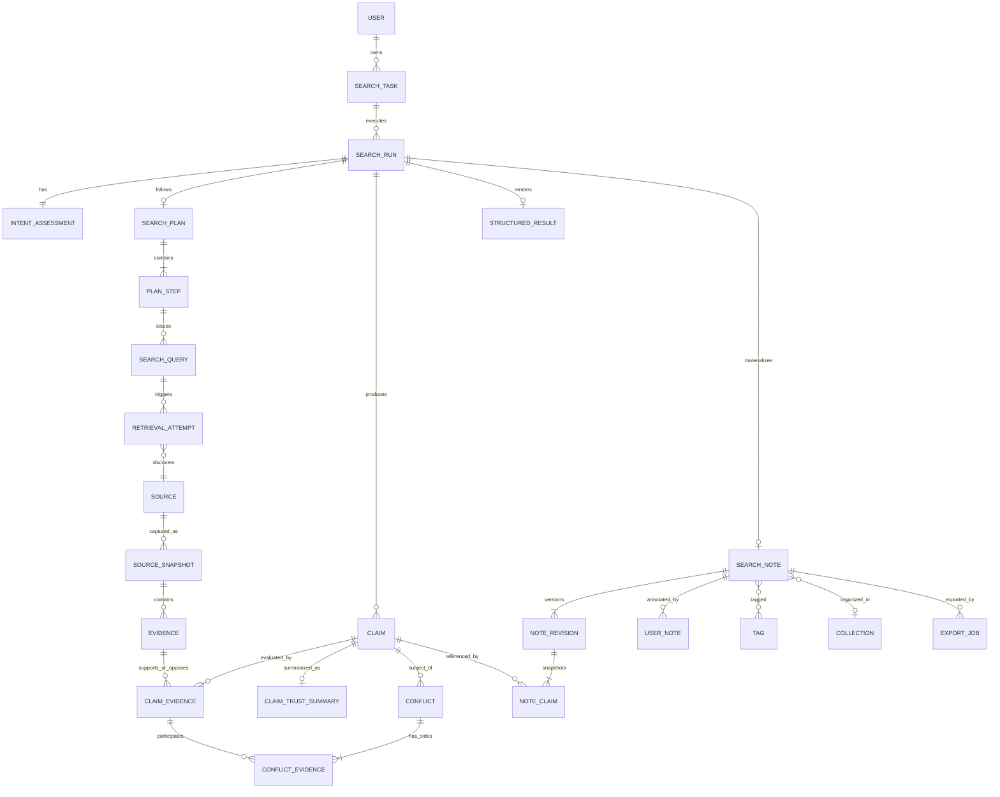

# Siftory V0.1 领域与数据模型

## 1. 核心决策

**Claim 是 Siftory 的核心知识单位。**

- URL 只是 Source 的地址，不是知识本身；
- 网页摘录只是 Evidence，不是最终结论；
- Answer 是对 Claims 的呈现，不是唯一事实来源；
- 聊天消息可以存在于交互层，但不能承载产品核心数据；
- Search Note 是指定 SearchRun 的结构化知识快照，不是富文本页面的反向解析结果。

V0.1 推荐使用关系数据库保存领域关系，`jsonb` 只用于不同 Provider 的原始元数据、灵活定位信息和渲染配置。关键关系不得只塞进 JSON。

## 2. 聚合边界



聚合约束：

- SearchRun 聚合拥有执行过程、Claims 和最终 StructuredResult；
- Source 可跨 Run 复用，SourceSnapshot 是某一时刻不可变的抓取结果；
- SearchNote 聚合拥有 Library 元数据、用户笔记和 revisions；
- TrustAssessment 属于 Claim–Evidence 关系，而不是 Source 的永久属性。

## 3. 标识、时间与通用字段

推荐所有内部主键使用 UUIDv7；外部公开 ID 使用随机、不可枚举的字符串。所有时间使用 UTC、ISO 8601。

通用字段：

```text
id              uuid
created_at      timestamptz
updated_at      timestamptz
schema_version  smallint
```

不可变对象（SourceSnapshot、Evidence、NoteRevision）不更新正文；内容变化时创建新记录。

## 4. Search 聚合

### 4.1 SearchTask

表示用户的一个问题，可包含多次不同模式、重试或更新运行。

| 字段 | 类型 | 说明 |
| --- | --- | --- |
| id | uuid | 主键 |
| owner_id | uuid | 所属用户 |
| original_question | text | 用户原始输入，不覆盖 |
| current_question | text | 用户修订后的当前问题 |
| context_json | jsonb | 结构化约束或附件引用；不存运行产物 |
| status | enum | active / archived / deleted |
| latest_run_id | uuid? | 快速访问，必须指向本 Task 的 Run |
| created_at / updated_at | timestamp | 生命周期时间 |

### 4.2 SearchRun

一次不可混淆的 Agent 执行。切换模式、完全重跑、Update 都创建新 Run。

| 字段 | 类型 | 说明 |
| --- | --- | --- |
| id | uuid | 主键 |
| task_id | uuid | 所属 SearchTask |
| parent_run_id | uuid? | continue / retry / update 来源 |
| trigger | enum | initial / mode_switch / retry / continue / update |
| requested_mode | enum | auto / quick / compare / research |
| selected_mode | enum? | quick / compare / research |
| mode_confidence | decimal? | 内部分类置信度；非 Trust 分数 |
| state | enum | 状态机中的运行状态 |
| current_stage | enum | 最近阶段，供 UI 恢复 |
| budget_json | jsonb | 查询、来源、轮次、token、耗时预算 |
| budget_used_json | jsonb | 实际消耗 |
| stop_reason | enum? | 状态机定义的停止原因 |
| partial_reason | text? | 部分完成说明 |
| error_code / error_detail | text? | 失败信息；detail 不直接展示给用户 |
| started_at / completed_at / cancelled_at | timestamp? | 运行时间 |

索引：`(task_id, created_at desc)`、`(owner through task, state)`；状态更新使用乐观锁或版本号避免并发覆盖。

### 4.3 IntentAssessment

| 字段 | 类型 | 说明 |
| --- | --- | --- |
| run_id | uuid | 一对一主键 |
| normalized_question | text | 规范化问题 |
| entities_json | jsonb | 候选项、主题和实体 |
| constraints_json | jsonb | 时间、地区、版本等 |
| freshness_requirement | enum | realtime / recent / versioned / timeless / unknown |
| ambiguity_notes | text[] | 未阻塞的歧义 |
| assumptions | text[] | 系统采用的假设，结果页可披露 |
| classifier_version | text | 可复现模式判断 |

### 4.4 SearchPlan / PlanStep

SearchPlan 保存 `run_id`、`version`、`status`、`stop_conditions_json`。计划修改时递增 version，不覆盖历史事件。

PlanStep：

| 字段 | 类型 | 说明 |
| --- | --- | --- |
| id / plan_id | uuid | 标识和归属 |
| parent_step_id | uuid? | Research 子主题层级；限制合理深度 |
| goal | text | 子目标 |
| expected_claim_types | text[] | 预计验证的陈述类型 |
| preferred_source_types | enum[] | official / github / paper / web 等 |
| priority | smallint | 处理优先级 |
| status | enum | pending / running / completed / skipped / failed |
| completion_criteria_json | jsonb | 该步骤完成规则 |
| order_key | text | 稳定排序，不依赖创建时间 |

### 4.5 SearchQuery / RetrievalAttempt

SearchQuery 是 Agent 计划执行的语义查询；RetrievalAttempt 是一次 Provider 调用。

SearchQuery 关键字段：`run_id`、`step_id`、`round`、`query_text`、`query_hash`、`source_scope`、`purpose`、`status`。

RetrievalAttempt 关键字段：`query_id`、`provider`、`idempotency_key`、`status`、`result_count`、`latency_ms`、`error_code`、`provider_metadata_json`。

唯一约束：`UNIQUE(idempotency_key)`。

### 4.6 RunEvent

RunEvent 是追加写入的状态和审计日志：`run_id`、`sequence`、`event_type`、`from_state`、`to_state`、`step_id`、`payload_summary_json`、`created_at`。

唯一约束：`UNIQUE(run_id, sequence)`。事件正文不存完整网页或敏感 prompt。

## 5. Evidence 聚合

### 5.1 Source

Source 表示规范化资源，而非一次抓取。

| 字段 | 类型 | 说明 |
| --- | --- | --- |
| id | uuid | 主键 |
| canonical_url | text | 规范化 URL |
| url_hash | text | 去重索引 |
| source_type | enum | official_doc / github / paper / government / article / forum / other |
| title / publisher / domain | text? | 来源元数据 |
| author_json | jsonb | 作者列表和标识 |
| published_at / updated_at_source | timestamp? | 来源自身时间 |
| language | text? | BCP 47 |
| primary_hint | enum | primary / secondary / unknown，仅为来源属性提示 |
| metadata_json | jsonb | Provider 特有元数据 |

注意：`primary_hint` 不是最终判断。同一来源对产品 API Claim 可能是第一方，对用户实际体验 Claim 可能并不具备第一方优势。

唯一约束：`UNIQUE(url_hash)`；URL canonicalization 规则需版本化。

### 5.2 SourceSnapshot

表示某次实际读取到的不可变内容。

| 字段 | 类型 | 说明 |
| --- | --- | --- |
| id / source_id | uuid | 标识和来源 |
| retrieval_attempt_id | uuid? | 抓取 provenance |
| fetched_at | timestamp | 访问时间 |
| content_hash | text | 内容去重和变更判断 |
| content_type | text | MIME type |
| title_at_fetch | text? | 当时标题 |
| published_at_observed | timestamp? | 当时解析出的时间 |
| version_label | text? | 文档 / 软件版本 |
| storage_ref | text | 原始或清洗后内容的安全对象引用 |
| parse_status | enum | parsed / partial / failed / blocked |
| parser_version | text | 可复现提取 |

同一 Source 内容未变化时可复用 Snapshot，但必须为新 Run 保存引用关系和实际访问时间。

### 5.3 Evidence

Evidence 是 Snapshot 内能够支持或反驳 Claim 的最小可定位内容。

| 字段 | 类型 | 说明 |
| --- | --- | --- |
| id / snapshot_id | uuid | 标识和所属快照 |
| evidence_type | enum | quote / table / code / data / metadata / visual |
| excerpt | text | 最小必要摘录，遵守版权和长度限制 |
| paraphrase | text? | 对证据的结构化释义 |
| locator_json | jsonb | heading、段落、行、页码、DOM selector、时间戳等 |
| evidence_hash | text | 同 Snapshot 内去重 |
| extraction_method | enum | model / parser / user |
| extractor_version | text | 可复现提取 |
| language | text? | 证据语言 |

唯一约束：`UNIQUE(snapshot_id, evidence_hash)`。

## 6. Claim 聚合

### 6.1 Claim

Claim 是一个可验证的、带语境的陈述。它属于产生它的 SearchRun。

| 字段 | 类型 | 说明 |
| --- | --- | --- |
| id / run_id | uuid | 标识和所属 Run |
| statement | text | 面向用户的完整陈述 |
| normalized_statement | text | 用于去重 / diff 的规范化表示 |
| statement_hash | text | 同 Run 去重辅助 |
| subject_json | jsonb | 主题实体，可为空但应尽量结构化 |
| scope_json | jsonb | 时间、地区、版本、条件、单位 |
| claim_type | enum | fact / capability / comparison / recommendation / forecast / definition / procedure |
| importance | enum | decisive / key / supporting / background |
| verifiability | enum | verifiable / interpretive / normative |
| status | enum | candidate / evaluated / included / excluded |
| extraction_provenance_json | jsonb | 由哪个 Evidence / synthesis step 发现 |

唯一约束建议：`UNIQUE(run_id, statement_hash)`，但 hash 冲突或语义近似去重需要人工 / 模型判定记录，不能只靠字符串。

Recommendation 也作为 Claim，但必须将条件写入 `scope_json`，并链接支撑其判断的事实 Claims。

### 6.2 ClaimRelation

用于表达 Claim 之间的知识关系，并提前支持 Living Note：

| 字段 | 类型 | 说明 |
| --- | --- | --- |
| from_claim_id / to_claim_id | uuid | 两端 Claim |
| relation | enum | supports / depends_on / refines / supersedes / contradicts / equivalent_to |
| rationale | text? | 关系理由 |
| confidence | enum | high / medium / low |
| created_by | enum | system / user |

`supersedes` 和跨 Run `equivalent_to` 在 V0.1 可少量使用，但数据结构必须保留，以支持后续 Update diff。

### 6.3 ClaimEvidence

这是 Trust Engine 最重要的关系表。

| 字段 | 类型 | 说明 |
| --- | --- | --- |
| id / claim_id / evidence_id | uuid | 关系标识 |
| stance | enum | supports / contradicts / qualifies / contextual |
| relevance | enum | direct / partial / contextual / unrelated |
| authority | enum | strong / adequate / weak / unknown |
| primary_context | enum | primary / secondary / mixed / unknown |
| freshness | enum | current / acceptable / stale / unknown |
| independence_group | text? | 转载 / 同源内容归为同组 |
| assessment_notes | text[] | 可向用户解释的原因 |
| evaluator_version | text | 可复现评价 |
| assessed_at | timestamp | 评价时间 |

唯一约束：`UNIQUE(claim_id, evidence_id)`。

关键原则：Authority、Primary、Freshness、Relevance 都存放在 ClaimEvidence 上，因为它们依赖当前 Claim 和语境。

### 6.4 ClaimTrustSummary

聚合多个 ClaimEvidence 的可解释摘要，可重新计算。

| 字段 | 类型 | 说明 |
| --- | --- | --- |
| claim_id | uuid | 一对一主键 |
| level | enum | high / medium / low / insufficient |
| supporting_evidence_count | int | 支持证据数 |
| contradicting_evidence_count | int | 反对证据数 |
| independent_support_count | int | 独立支持组数 |
| primary_source_count | int | 对当前 Claim 为第一方的来源数 |
| reason_codes | enum[] | 确定性原因代码 |
| explanation | text | 用户可读解释 |
| unresolved_conflict | bool | 是否存在实质未解决冲突 |
| ruleset_version | text | Trust 规则版本 |
| evaluated_at | timestamp | 评估时间 |

不得只保存 explanation；必须保存 reason codes、计数和 ruleset version，确保解释可审计。

### 6.5 Conflict / ConflictEvidence

Conflict 描述证据或 Claims 对同一问题的不一致。

Conflict 字段：`run_id`、`subject_claim_id`、`conflicting_claim_id?`、`conflict_type`（factual / version / temporal / scope / methodology / interpretation）、`severity`（minor / material）、`status`（open / explained / resolved）、`summary`、`resolution_notes`。

ConflictEvidence 字段：`conflict_id`、`claim_evidence_id`、`side`（a / b / context）。

规则：冲突被解释不等于证据被删除；双方关系和 resolution 必须同时保留。

## 7. Presentation 聚合

### StructuredResult

StructuredResult 是 Run 的呈现规格，而不是一段 Markdown：

| 字段 | 类型 | 说明 |
| --- | --- | --- |
| run_id | uuid | 一对一主键 |
| result_status | enum | complete / partial / draft |
| title | text | 结果标题 |
| answer_ast_json | jsonb | 受控节点：heading、paragraph、list、table、claim_ref |
| decisive_claim_ids | uuid[] | 决定主答案的 Claims |
| key_claim_ids | uuid[] | 默认展示的 Key Evidence |
| overall_confidence | enum | high / medium / low / insufficient / mixed |
| confidence_reason_codes | enum[] | 总览理由 |
| limitations | text[] | 缺口和限制 |
| comparison_json | jsonb? | Compare 的候选、维度及 Claim refs |
| synthesis_version | text | 生成器版本 |

`answer_ast_json` 只存结构和 `claim_ref`，事实依据仍来自 Claim 聚合。Renderer 必须拒绝不存在的 Claim refs。

## 8. Knowledge 聚合

### 8.1 SearchNote

SearchNote 是 Library 中的稳定身份和用户可编辑元数据。

| 字段 | 类型 | 说明 |
| --- | --- | --- |
| id / owner_id | uuid | 标识和所属用户 |
| task_id / source_run_id | uuid | 来源问题和首次保存 Run |
| title | text | 用户可编辑标题 |
| collection_id | uuid? | 空即 Inbox |
| is_favorite | bool | 收藏 |
| auto_saved | bool | 是否由用户设置自动保存 |
| current_revision_id | uuid | 当前系统知识版本 |
| created_at / updated_at / last_viewed_at | timestamp | Library 排序 |
| deleted_at | timestamp? | 软删除与恢复窗口 |

一个 Note 最多属于一个 Collection，可拥有多个 Tags。V0.1 Collection 不嵌套。

### 8.2 NoteRevision / NoteClaim

NoteRevision 是指定 Run 的不可变知识快照：`note_id`、`revision_no`、`source_run_id`、`summary_ast_json`、`overall_confidence`、`change_summary_json?`、`created_at`。

NoteClaim 固定该 revision 使用的 Claim：`revision_id`、`claim_id`、`display_order`、`section_key`、`is_key`、`statement_snapshot`、`trust_level_snapshot`。

保存 statement / trust snapshot 是为了让旧导出可复现；Claim 的原始记录和关系仍保留。

唯一约束：`UNIQUE(note_id, revision_no)`、`UNIQUE(revision_id, claim_id)`。

### 8.3 UserNote

用户内容与系统事实层分开保存：

| 字段 | 类型 | 说明 |
| --- | --- | --- |
| id / note_id / author_id | uuid | 标识与归属 |
| anchor_type | enum | note / claim / evidence |
| anchor_id | uuid? | 对应 Claim 或 Evidence |
| body | text | 用户原文 |
| position | int | 展示顺序 |
| created_at / updated_at | timestamp | 编辑时间 |

### 8.4 Tag / Collection

- Tag：`owner_id`、`name`、`normalized_name`、`color?`；`UNIQUE(owner_id, normalized_name)`。
- NoteTag：`note_id`、`tag_id`、`source`（ai_suggested / user）、`confirmed_at?`。
- Collection：`owner_id`、`name`、`description?`、`position`；V0.1 无 parent_id。

AI 建议的 Tag 在用户确认前可显示为建议，但不得和用户已确认分类混淆。

### 8.5 ExportJob

| 字段 | 类型 | 说明 |
| --- | --- | --- |
| id / note_id / revision_id | uuid | 指定导出版本 |
| format | enum | markdown / docx |
| options_json | jsonb | 是否含 My Notes、引用样式等 |
| renderer_version | text | 可复现输出 |
| status | enum | queued / rendering / completed / failed / expired |
| artifact_ref | text? | 文件对象引用 |
| checksum | text? | 完整性验证 |
| expires_at | timestamp? | 临时下载有效期 |
| error_code | text? | 失败原因 |

导出必须绑定 revision，避免导出过程中 Note 更新造成内容漂移。

## 9. 枚举基线

```text
SearchMode       QUICK | COMPARE | RESEARCH
RequestedMode    AUTO | QUICK | COMPARE | RESEARCH
RunState         CREATED | UNDERSTANDING | PLANNING | RETRIEVING |
                 EXTRACTING | EVALUATING | GAP_CHECK | SYNTHESIZING |
                 MATERIALIZING | COMPLETED | PARTIAL | FAILED | CANCELLED
TrustLevel       HIGH | MEDIUM | LOW | INSUFFICIENT
OverallTrust     HIGH | MEDIUM | LOW | INSUFFICIENT | MIXED
EvidenceStance   SUPPORTS | CONTRADICTS | QUALIFIES | CONTEXTUAL
ClaimImportance  DECISIVE | KEY | SUPPORTING | BACKGROUND
ConflictSeverity MINOR | MATERIAL
```

数据库值使用稳定的大写 code；展示文案通过本地化层映射，不把中文或英文显示文本写入枚举。

## 10. 关键不变量

应用层和数据库约束共同保证：

1. Claim 必须属于一个 SearchRun。
2. Evidence 必须属于一个不可变 SourceSnapshot。
3. ClaimEvidence 的 Claim 和 Evidence 必须能追溯到同一 Run 的检索过程，跨 Run 复用需显式建立 provenance link。
4. Decisive Claim 没有支持证据时，TrustLevel 必须为 `INSUFFICIENT`。
5. 存在未解决的 material Conflict 时，该 Claim 不得为 `HIGH`。
6. StructuredResult 引用的 Claim 必须属于该 Run。
7. SearchNote.current_revision_id 必须属于该 Note。
8. NoteRevision.source_run_id 与保存的 NoteClaims provenance 一致。
9. 删除 Note 不级联删除 SearchRun、Claim、Evidence 或 Source；使用软删除。
10. 用户 My Notes 永远不进入系统 Evidence，除非未来通过明确“作为用户证据提交”的流程。

## 11. 去重与独立性

| 对象 | V0.1 去重策略 |
| --- | --- |
| Source | canonical URL + URL normalization version |
| Snapshot | source_id + content_hash |
| Evidence | snapshot_id + evidence_hash |
| Claim | run_id + normalized statement hash，再做语义近似检查 |
| Independent source | publisher / canonical origin / content fingerprint 组合分组 |
| Tag | owner_id + normalized name |

URL 不同不代表来源独立；同一新闻稿被多站转载应归入同一个 independence group。

## 12. 权限和隐私边界

- SearchTask、SearchRun、SearchNote、UserNote、Tag、Collection 都必须通过 owner scope 查询。
- Source 和公开 Snapshot 可以去标识化共享缓存；私人、付费或带凭据内容必须隔离到用户作用域。
- artifact_ref / storage_ref 使用短期签名访问，不直接暴露内部存储路径。
- 软删除后的用户笔记和导出文件遵循可配置保留期；V0.1 UI 应支持删除 Note。
- Provider 原始响应不得默认永久保存，只保留重现证据链所必需的内容。

## 13. Living Note 的前置兼容

V0.1 不实现自动长期监控，但模型必须支持未来 Update：

```text
旧 NoteRevision
      +
新 Update SearchRun
      ↓
Claim matching + ClaimRelation
      ↓
新 NoteRevision + ChangeSet
```

未来状态映射：

| Change 状态 | 数据推导 |
| --- | --- |
| NEW | 新 Run Claim 无旧 revision 等价 Claim |
| UPDATED | 新 Claim refines / supersedes 旧 Claim |
| OUTDATED | 旧 Claim 被新 Evidence 反驳或作用域过期 |
| UNCHANGED | equivalent_to 且 Trust / scope 无实质变化 |
| CONFLICTING | 新旧或新证据产生 material unresolved Conflict |

因此 V0.1 已保留：`parent_run_id`、`trigger=update`、不可变 Snapshot、ClaimRelation、NoteRevision 和 ruleset / renderer version；但不提前实现监控调度、复杂 diff UI 或自动合并。

## 14. 示例对象链

```json
{
  "searchTask": {
    "question": "LangGraph 和 CrewAI 怎么选？"
  },
  "searchRun": {
    "requestedMode": "AUTO",
    "selectedMode": "COMPARE",
    "state": "COMPLETED"
  },
  "claim": {
    "statement": "LangGraph 支持持久化 checkpoint。",
    "claimType": "CAPABILITY",
    "importance": "KEY",
    "scope": { "version": "observed at search time" }
  },
  "claimEvidence": [
    {
      "stance": "SUPPORTS",
      "relevance": "DIRECT",
      "authority": "STRONG",
      "primaryContext": "PRIMARY",
      "sourceType": "OFFICIAL_DOC"
    },
    {
      "stance": "SUPPORTS",
      "relevance": "DIRECT",
      "authority": "STRONG",
      "primaryContext": "PRIMARY",
      "sourceType": "GITHUB"
    }
  ],
  "trustSummary": {
    "level": "HIGH",
    "reasonCodes": [
      "DIRECT_EVIDENCE",
      "PRIMARY_SOURCE",
      "CROSS_VERIFIED",
      "NO_MATERIAL_CONFLICT"
    ]
  }
}
```

这段 JSON 仅展示 API 组合视图；数据库仍使用前述独立实体和关系表。
